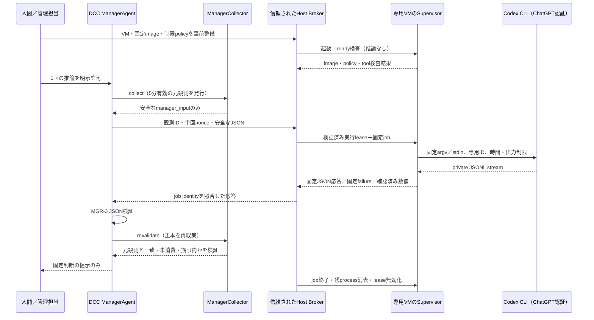

# Manager推論の隔離設計 — Codex CLI / ChatGPT認証

- 状態：**Proposed／安全性の成立未確認。実装・本番起動の承認依頼ではない**
- 調査日：2026-10-22（日本時間）
- 対象：Codex CLI 0.155.1、development-management の専用branch `codex/mgr-1-manager-overview`
- コード確認基準：`d428a470c0ccdb347463bae742b217615362296d`（MGR-6-fix）
- 決定者：利用者と、OS・ネットワーク・認証を管理する担当者
- 方針：**専用Linux VM＋信頼された実行Brokerを第一候補とする。全ゲートを満たすまでは `PROVIDER_POLICY_UNVERIFIED` を維持する。**

## 1. 現在の実装と調査結果

### 1.1 守る境界

Managerに渡す業務入力はMGR-4の `manager_input` だけとする。ManagerはMGR-3の5種類の固定JSON判断を返すだけで、TASK本文、リポジトリ、業務データ、ホストの設定・認証ファイルを受け取らない。OpenAI APIや他の従量課金API、APIキー認証への切替は導入しない。Codex CLIがChatGPT認証でサービスと通信することは必要だが、DCCからサービスの非公開エンドポイントを直接呼ぶ実装にはしない。

MGR-6-fixの `ManagerCodexProvider` は既存 `CodexProvider.run_review()` と解析を再利用する。空の一時cwdとCLI設定は防御策だが、OS隔離の証明ではない。`isolation_check` 未設定時は推論開始前に停止する。設定不足を無視するfallbackは作らない。

MGR-4は同一プロセス内の元観測を保持し、再収集した完全な計画・revision・Run対応・固定Run観測と照合する。観測は既定300秒、検証試行は一度限りで、通常の再収集は前の観測を無効化する。隔離導入でもこの検証をホスト側に残す。

### 1.2 今回確認したこと／しなかったこと

読み取りでbranch・HEAD・既存コードを確認した。ローカルの `codex.cmd --version` は0.155.1。`exec --help` は `read-only`、`--strict-config`、`--ignore-user-config`、`--ignore-rules`、`--ephemeral` を、`login --help` は `--device-auth` を示した。ヘルプにあることは、設定の実効性や認証成功の証明ではない。

過去の実機 `PROVIDER_PROTOCOL` の直接原因は未確定。非JSONLのプロセス失敗を既存解析がprotocolへまとめ得ることは、MGR-6-fixで切り分け済み。removedの `apply_patch_freeform`／`js_repl` だけが原因とは断定しない。

**新しい調査所見：** 0.155.1タグの設定schemaでは、画像閲覧の指定は `features.view_image` に存在する一方、`ToolsToml` に `view_image` はない。現在の `tools.view_image=false` は、この版のschemaと不整合の候補であり、strict設定での失敗要因として次タスクで確認すべきである。今回は文書のみで、起動コードを変更しない。現行最新版ドキュメントを過去版へそのまま当てはめない。[0.155.1の設定schema](https://raw.githubusercontent.com/openai/codex/rust-v0.155.1/codex-rs/core/config.schema.json)

実推論、ログイン実行、認証ファイルの参照・コピー、WSL／Sandbox／VMの起動・導入、ユーザー作成、権限・ネットワーク設定変更は行っていない。ホストのWindowsエディション、仮想化対応、管理ポリシーも未確認である。

## 2. CLI設定とOS保証の違い

| 対象 | 設定による意図・0.155.1での確認範囲 | 別途必要な保証／未確認事項 |
|---|---|---|
| `exec --sandbox read-only` | 書込可能な開発モードを選ばない | コマンドを「起動しない」指定ではない。ホストの読取可能範囲を空cwdだけには限定しない |
| `approval_policy='never'` | 承認待ち・権限昇格の相談をしない | サンドボックス内で許可された操作を全禁止する設定ではない |
| `features.shell_tool=false`、`unified_exec=false` | コマンド用ツールを抑制する方針 | 実効ツール一覧とdispatchを版固定で確認し、OSでも追加execを拒否する |
| Code Mode、multi-agent、画像・browser等 | 不要な実行面を無効化する方針 | 別経路のツールや管理側追加を含め、許可した全設定の型と優先順位を確認する |
| MCP・apps・plugins | CLI側で露出を抑える | 空tableの指定を全設定層の消去とみなさない。実効server数0、外部起動0を検査する |
| `--ignore-user-config` | ユーザーconfig.tomlを読まない | 認証は引き続きCODEX_HOMEを使用する。管理設定・自動指示・skillsまで全無効とは断定しない |
| `project_doc_max_bytes=0`、`--ignore-rules` | プロジェクト指示等の混入を抑える | ホスト全体の読取防止にはならず、既存rulesの非継承を安全保証とも扱わない |
| `--ephemeral` | セッション永続化を抑える | 認証cache・更新・診断ログを含む、あらゆる書込の禁止ではない |
| 空の一時cwd | 業務ファイルを作業場所へ置かない | 同一Windowsユーザーが読める他の場所、環境変数、loopback、IPCは別の資源である |

0.155.1のschemaは設定の形を確認する根拠で、実行時に全ツールが消える証拠ではない。現行の公式説明も、コマンドのnetwork制限と、MCP・Web・サービス通信を分けている。主プロセス、ツール、子プロセスの全体を守るにはCLI外の制御が必要となる。[公式権限説明](https://learn.chatgpt.com/docs/permissions)

WindowsのCodex sandboxはコマンドと子プロセスに対する境界を提供する。現行説明のMXC推奨や0.162.0以降の確認例を、0.155.1で利用可能・成立済みとは扱わない。実装方式、OS build、fallback、ネットワーク・deny-readの挙動を対象版で検証する必要がある。[Windows sandbox](https://learn.chatgpt.com/docs/windows/windows-sandbox)

## 3. 隔離方式の比較

以下のコスト・適合性は設計上の評価であり、当該PCでの成立を確認した結果ではない。

| 方式 | ホスト境界・必要な制御 | 認証・状態保持 | DCC接続／運用コスト | 判定 |
|---|---|---|---|---|
| A：WSL2＋専用Linux環境 | automount・interopを無効化し、専用ユーザー、mount namespace、MAC、通信制限を追加しても、同じWindowsユーザーのWSLを独立したホスト境界とはみなせない | Windowsログインは自動継承しない。同じChatGPTアカウントでゲスト側ログインが必要 | 起動・更新は比較的容易。ただし共有utility VM、host IPC、Windows資源への経路の検査が複雑 | 単独では不採用 |
| B：Windows Sandbox | ハイパーバイザーによる境界。共有・clipboard・音声・映像・プリンター等を無効化。オンライン利用には別の通信制限も必要 | 閉じると状態消去。毎回ログインか、安全な永続化の追加設計が必要。ホスト認証の共有は禁止 | 一時検証には向く。常用の認証継続と非GUI lifecycle・出力回収が難しい | 隔離試験用候補、常用は不採用 |
| C：専用Windows制限付きプロセス | 専用SID、限定ACL／AppContainer、実行制御、handle制限、Job、Firewall等の組合せ。専用ユーザーだけでは公開read ACLを防げない | ユーザー固有の認証を分離できるが、CLI／credential storeとの互換性が未確認 | 名前付きpipeをACLで限定可能。Node shim・子プロセス・IPC・管理設定まで自前設計となり難易度が高い | 現段階では不採用 |
| D：専用の完全Linux VM＋Broker | 共有mount・clipboard・drive/device転送なし。ゲストMAC／exec制限と、外側の通信制限を重ねる。ホストへは専用の定型通信だけ | 同じChatGPTアカウントで独立ログインし、ゲスト内でcacheを保持。ホストのtokenは渡さない | イメージ、ゲスト更新、Broker、認証維持が必要。常用の状態保持と境界を分離しやすい | **第一候補。ただし成立未確認** |
| D参考：通常のcontainer／別cwdだけ | host共有やdaemon socketを残すと境界が弱い。container engineやmountも追加の管理対象 | 認証volumeを広くmountする案は不採用 | 初期設定は軽く見えるが安全性検査は省略できない | 単独の代替にはしない |

### A：WSL2の注意

`automount.enabled=false` と `interop.enabled=false` は、Windows driveの自動mountとWindowsプログラム起動の通常経路を抑える設定である。既存mount、fstab、network共有、socket、権限の高いLinuxユーザーによる再設定は別に検査する。適用には再起動が必要で、全distroを止める操作は他作業に影響するため今回行わない。[WSL設定](https://learn.microsoft.com/en-us/windows/wsl/wsl-config)

MicrosoftはWSLを未信頼コード用のsecurity sandboxとは位置付けず、同一ユーザーのdistro間やWindowsホストとの独立した安全境界とはしていない。したがって `/mnt/c` が見えないことだけで合格にはしない。[WSL security model](https://raw.githubusercontent.com/microsoft/WSL/master/doc/docs/technical-documentation/security.md)

### B：Windows Sandboxの注意

ホストにあるCLIがそのままゲストに現れるわけではなく、ゲスト側への配置が必要。終了時の状態消去と認証継続の相性が悪い。対応Windowsエディションとハードウェア仮想化が前提で、ネットワークは既定有効のため、既定状態では採用しない。[Windows Sandbox概要](https://learn.microsoft.com/en-us/windows/security/application-security/application-isolation/windows-sandbox/)

共有folderのread-onlyは閲覧を許す設定であり、秘密の保護にはならない。出力folderだけを共有してもホストへの書込経路になる。Clipboard、映像・音声、printer、vGPU等を最小化し、共有folderを使わないIPC方式を優先する。`.wsb` のNetworkingをDisableにするだけではCodexに必要な通信も止まるため、許可先制御の別設計が要る。[Sandbox構成](https://learn.microsoft.com/en-us/windows/security/application-security/application-isolation/windows-sandbox/windows-sandbox-configure-using-wsb-file)

### C：制限付きWindowsプロセスの注意

AppContainerはcapabilityと資源アクセスを制限する仕組みである。ただし既存CLIをそのまま移せる保証はなく、認証store・ファイル・名前付きpipe・networkとの互換性検証が必要。[AppContainer isolation](https://learn.microsoft.com/en-us/windows/win32/secauthz/appcontainer-isolation)

Job Objectは一群のプロセスの制限・終了管理に使えるが、それだけで読取ACLやnetwork境界は完成しない。子プロセス数を1に固定する案も、CLIの正当なlauncherを含む構成と整合するか確認が必要である。[Job Objects](https://learn.microsoft.com/en-us/windows/win32/procthread/job-objects)

## 4. 推奨方式・保証範囲・Windows適合条件

**推奨はD：Hyper-V上の専用Linux VM＋管理者が用意する信頼されたBroker。** 比較対象の中で、ホストの開発環境をゲストに公開せず、認証の状態をゲスト内に保持する設計を最も明確に分けられるためである。最小の初期費用だけで選んだ方式ではない。

Hyper-VはWindowsのoptional featureだが、Microsoftの案内ではHomeにHyper-V roleを導入できない。Pro／Enterprise、64bit CPU・SLAT等の要件と、既存の仮想化製品との互換性を確認する。このPCの適合は未確認。Homeだった場合にエディション変更を自動実施せず、本推奨は導入保留とする。[Hyper-V要件](https://learn.microsoft.com/en-us/windows-server/virtualization/hyper-v/get-started/Install-Hyper-V)

| 保証対象 | 設計上の実施場所 | 合格まで残ること |
|---|---|---|
| ホストのrepo・業務ファイルの非公開 | VMの独立disk、共有mount／device転送なし | host path、共有、IPC、network経由の到達不能をcanaryで確認 |
| model由来のshell・編集・MCP起動禁止 | CLIの実効tool抑制＋guestのMAC／exec制限 | modelに露出するtool一覧0と、禁止toolのdispatch拒否を確認。未知toolは拒否 |
| CLI自身の読取最小化 | guest workerの専用ID・限定filesystem | runtime・認証・最小設定以外のread拒否。空cwdだけで合格にしない |
| 子プロセス・持続processの抑制 | guest supervisor／cgroupとexec制限 | 起動時のnative CLIだけを許し、その後のshell／新しいCLI／interpreter起動を拒否 |
| 外部操作の抑制 | guestと外側の通信policy | Codex認証・推論に必要な宛先だけ。LAN・host loopback・任意IPへ到達不可 |
| 認証情報の保護 | guest内の専用credential領域 | CLIの正当な認証更新だけを許す。認証値をmodel入力・出力・通常logへ渡さない |
| 判断の安全性 | hostのMGR-3／4 | VMの自己申告を信用せず、固定JSON検証と正本の再収集を実施 |

VMだけでは、ゲスト内でのshellやファイル変更を禁止しない。guest workerにも管理者権限・sudo・package manager・Docker socket・SSH鍵・共有repoを与えない。AppArmor等のMAC、namespace、seccomp等の組合せは**実装候補**であり、成立済み設定例ではない。単に `/bin/sh` を消すだけでは別interpreterや再実行を防げない。CLI起動用wrapperとmodelに許す子プロセスを混同しないため、native実行物を固定し、起動後の追加exec拒否を実証する。

認証refresh、CLIの最小cache、一時通信に必要なruntime書込と、modelが要求する業務ファイルの編集は分離する。前者まで全面禁止するとログイン維持と矛盾する。CLI・kernel・hypervisor・Brokerは信頼基盤であり、それら自体が侵害された場合の完全な耐性は保証しない。modelへ渡した安全なJSONがCodexサービスへ送信されることも、この設計では禁止できず、利用条件の前提となる。

## 5. ChatGPT認証・通信・追加費用

### 5.1 認証

- 利用方式は同じ既存ChatGPTアカウント／workspaceによるCLIログインに固定する。APIキー、自動課金fallback、別の従量課金Providerは使わない。
- **ホストのログインsessionをコピーなしにそのままVMへ移せるとは確認できていない。** 提案はguest内での別sessionへの人間による再ログインである。同じアカウントの利用枠を使う意図だが、対象plan／workspaceの可否は人間が確認する。
- device code方式は公式案内に存在し、ローカル0.155.1のhelpにも `--device-auth` がある。利用可否はアカウント・管理設定次第。guestにブラウザーやhost driveを公開する代わりに、人間の別ブラウザーで承認する方式を候補にする。
- hostのauth cache共有・コピー、tokenをDCCへ読み出す認証relay、ログインコードやtokenの保存は採用しない。guestのcredential storeを専用にし、session失効時は人間対応へ戻す。自動refreshは公式に説明されるが、失効後の永久無人運転は保証しない。

これらは認証方式の設計であり、今回ログイン・token参照は行っていない。APIキー認証はChatGPT内の利用枠とは別の課金経路になるため禁止する。[公式認証説明](https://learn.chatgpt.com/docs/auth)

認証付きVM disk、backup、checkpointは秘密を含むものとして限定する。未認証のベースimageだけを配布し、認証済み状態の複製・巻戻しでrefresh sessionを使い回さない。CLI本体が認証値へアクセスする必要は残るため、model由来のツールを別のprincipalで実行すれば安全になる、と簡単には扱わない。今回はツールを起動させない。

### 5.2 通信

CLIのコマンドsandbox用proxyだけでは、CLI本体のモデル・認証通信やMCP等の通信まで同じ制約にならない。全guestの外向き通信を管理側gateway／firewallで抑制し、tool・MCP・plugin・browser用経路は有効にしない。Codex本体に必要なservice通信は別に許可する。[通信制御の適用範囲](https://learn.chatgpt.com/docs/permissions)

許可先は「既知のOpenAI domainをすべて」「443全部」「IP固定で一度通った先」にはしない。認証・推論・refresh・redirect・WebSocket等の必要性を対象版で確認し、管理者が保守する最小宛先表を作る。現時点で完全な宛先・更新要件は未確定であり、**未解決の導入ゲート**である。DNS、直接IP、IPv6、UDP／QUIC、proxy回避、LAN、loopback、metadata宛先も負の試験に含める。TLS検証を無効化せず、必要なCA設定は人間が管理する。

bootstrapのCLI配布・OS更新・ログインと、通常の推論を分ける。bootstrapだけを理由に広く許した通信を推論時へ持ち込まない。推論のために新しいネットワーク許可をAIが作る入口は設けない。

### 5.3 費用・保守

API従量課金は追加しない。既存アカウントのCodex利用枠は消費し、他のCodex利用と独立した無料枠が増えるわけではない。追加creditsの自動購入・自動切替はしない。Windowsエディションや既存設備が適合すれば新たなAPI料金は不要だが、OSライセンス変更、RAM・disk、VM運用、更新・再認証の人的コストが生じ得る。追加費用ゼロとは断定しない。guest RAM 2〜4GB・disk 10〜20GBは初期検討用の仮置きで、ベンダー保証値でも実測値でもない。

## 6. DCCとの接続設計

### 6.1 構成図（将来案、未実装）

### 6.2 `isolation_check` を実体のある検査へ接続する

現在の `_call()` は、checkがTrueになってもその後は**ホストの `run_streaming()`** を呼ぶ。従って「VMを起動したのでTrue」では不十分で、既存hookだけを差し替えてもVM内実行にはならない。次タスクでは、Providerのtransportを固定Broker endpointへ委任する必要がある。既存Orchestrator Provider全体を改修せず、Manager専用実装に限定する。

BrokerはVM ID、imageとCLIのhash、policy版、通信policy、実効tool検査結果、専用principal、要求nonceとdeadlineを検証し、検証した環境でだけ使える単回leaseを作る。`isolation_check` はこのleaseと起動handleの一致を検査するアダプターにする。最終的にboolを返す場合も、単なる設定値やAIの自己申告を返してはならない。確認後に別cwd・別VM・別プロセスへ差し替わるTOCTOUを防ぐため、検証と起動を同じBroker操作に結び付ける。

通信はhost上の限定ACL付き名前付きpipeからBrokerへ、VMへは認証・peer identityを持つ専用チャネルを候補にする。Hyper-V socket等を評価するが、Linux guestとの対応と実装は未確認。汎用SSH shell、任意command RPC、host directoryの共有は提供しない。識別子・nonceは認証tokenではなく、認証情報をDCCへ中継しない。

入力schemaは `manager_input` と制御用ID・deadlineだけで、実行path、Provider名、argv、通信先、OS設定はAI入力や応答から受け取らない。Broker側の管理設定はManager workerが変更できない場所へ置く。stdout／stderrをhostの通常logへ流さず、private streamをbyte単位で上限まで読み、固定JSONを検証して返す。表示用に返せるのは既存固定結果と確認済み数値だけとする。

### 6.3 寿命・停止・正本検証

- VM準備・人間ログインを済ませ、ready検査が通ってからcollectする。VM起動・ログイン待ちで観測の5分を使い切る場合は新しいcollectからやり直す。
- 現在の既定120秒・設定上限240秒の推論timeout、16,000文字の判断、256,000文字のstream上限を維持する。新transportではさらにbyte/frame上限を設け、現状の「巨大な1行をcallback前にbufferし得る」問題を解消する。
- 単一DCC内のlockに加え、Brokerで複数DCCプロセス間の同時実行を拒否する。許可・開始・終了のIDは単回で、通信再送を新しい推論とみなさない。
- 停止要求・timeout・DCC切断は専用job全体の終了へ伝える。hostのclient processを止めるだけでguestに推論を残してはならない。guest自身にも強制deadlineを持たせる。
- どれかの検証・収集・lease確認に失敗すれば固定コードで拒否する。ローカルCLIへのfallbackはしない。
- 通常のプレビュー更新はAgentと同じCollectorのpending観測を勝手に更新しない設計にする。同じCollectorを共有してcollectすれば、正しく旧判断が無効になる。
- 検証後の実際のTASK変更・開始を行う将来の接続側は、改めて正本と既存Workflow／Runnerの権限・停止・上限・競合条件を確認する。BrokerはWorkflowの実行権限を持たない。

## 7. 必要な実装タスクの分解

| 順序 | 作業 | 完了証拠／停止条件 |
|---|---|---|
| 1 | 0.155.1の設定・tool生成・dispatchを版固定で監査。画像設定の不整合も再現 | 非推論の検査で実効設定とtool集合を確認。未知の実行面が残れば停止 |
| 2 | PCのエディション・CPU・VM基盤・管理制約・他作業への影響を人間が確認 | 専用VMを置ける条件と保守責任者が確定。今回は操作しない |
| 3 | 未認証の固定image、native CLI、専用worker ID、exec・read・通信制限を構築 | image／policy manifestと負の隔離試験が再現可能 |
| 4 | guestのChatGPT認証運用を設計・人間が実施 | host tokenの転送なしで同じaccountのCLI利用が可能。APIキーfallbackなし |
| 5 | Host Brokerとguest supervisor、単回lease、専用IPCを実装 | 変更不能なpolicy、TOCTOU防止、停止・期限・再送拒否をfakeで検証 |
| 6 | Manager専用transportをBrokerへ接続 | check成功後もローカル `run_streaming()` を使わないことを検証 |
| 7 | MGR-3／4、期限、一度限り、複数process lockとの回帰試験 | 正常fake応答だけが受理され、不正／古い応答で副作用0 |
| 8 | 人間が別途許可した最小1回の実CLI推論 | 全安全ゲート合格後のみ。今回の作業には含めない |

1・3・4・5の成立は未確認。現時点で8の実装承認・実推論の許可は求めない。CLI更新が必要になっても自動更新せず、差分監査と同じ試験をやり直す。

## 8. 人間が確認・承認すべき操作

今回、以下はすべて未実施である。

1. Windows feature有効化、仮想化設定・再起動、VM作成・RAM／disk割当。WF-6や既存作業を止めない保守時間を決める。
2. 共有・device転送・clipboard・host accessを無効にしたVM設定、Brokerの限定権限、guestのworker ID・MAC・exec policyの配置。
3. 既存ChatGPTアカウントでのguest独立ログイン、必要なdevice認証設定、認証cacheの保護・失効時の再認証。host tokenのコピーは承認対象にも含めない。
4. 通信先・CA・proxy・更新窓口の許可。必要先が確認できないなら接続範囲を広げず保留する。
5. 認証済みVMの保管・バックアップ・廃棄、ログの非秘密化、CLI／OS更新の担当。
6. 全負試験の結果確認後、利用枠を使う最小推論1回の明示許可。設定変更と推論許可を同じものとして扱わない。

既存ホストSIDのread権限、業務folderのACL、Orchestratorの設定は推論のために緩めない。

## 9. 完了判定に必要な隔離テスト

以下は**今後の試験計画であり、合格済みの記録ではない**。最初は偽Provider・合成canaryのみで行い、ユーザー業務データや実tokenを試験対象にしない。

| 試験 | 合格条件 |
|---|---|
| CLI版・設定差分 | hashとschemaが固定値に一致。未知・removed設定、型違い、設定layerの上書きを検知して停止 |
| tool inventory／dispatch | shell、画像・file read、browser、Code Mode、MCP、plugin、apps、sub-agent等の禁止面が使えない。新tool混入でfail closed |
| host read／write | 未共有の合成canary、host home、repo、network共有、drive転送、loopback／IPCへ到達できない |
| guest read／write | workerがruntime・最小設定・認証領域以外を読めず、保護したimage・policy・業務canaryを変更できない |
| 子process制限 | shell・別CLI・interpreter・Windows interop・MCP server・namespace昇格の起動がOSで拒否される。CLIの正当な初期起動は成立 |
| 通信制限 | 認証・推論の必要通信だけが成立。任意HTTPS／IP、DNS回避、IPv6、UDP、LAN、host loopbackは拒否 |
| 認証分離 | host cacheをmount・転送せずguestで独立認証。APIキー混入・別認証modeを拒否。値やcodeを通常logへ出さない |
| 正常fake判断 | 元snapshotに対する固定JSONが、最新正本が同一のときだけ一度受理される |
| 古い判断 | revision、本文のみ、TASK状態、Run対応・観測、対象一覧の変更、新collect、期限超過、再利用、再起動で拒否 |
| Broker耐性 | nonce再送、他VM、古いpolicy、偽lease、handle差替、command／path注入を拒否 |
| 停止・切断・上限 | child孫processを含むguest jobが終了。1行巨大出力、洪水、無応答でもmemoryと時間の上限内で終了 |
| 同時実行 | threadだけでなく複数DCC processからの二重推論を拒否。quota後の連続retryなし |
| 副作用 | Workflow保存・承認・Orchestrator・PUSH・BUILD・UPDATE・RELEASEの呼出し0。既存host環境の変更0 |
| 最小実推論 | 上記合格後に別途明示許可。ChatGPT認証で固定JSONのみ返り、同じ正本に対する検証まで成功 |

VMとBrokerの境界だけが合格しても、guest内の禁止tool・execが残れば完了ではない。認証更新やCLIの正当な実行を壊さずにこれらを満たせるかが、主要な未解決点である。

## 10. 利用枠節約・再利用・運用上の制限

通常の監視、件数集計、状態比較、依存判定、開始候補1件の選択はPythonで処理する。10秒の画面更新や、TASK／Runの状態変化だけを理由にManager AIを起動しない。

AIを呼ぶのは、目的や優先順位の比較、計画変更の検討など、人間が明示的に判断を求めた場合に限定する。現在の入力に業務目的・本文がないなら、その判断材料が不足していることを認め、文脈を勝手に追加したり繰り返し質問生成させたりしない。安全な型付き文脈の設計は別タスクとする。

| 再利用対象 | 許可できる条件 | 禁止する使い方 |
|---|---|---|
| 未検証の単一応答 | 元観測がまだ有効、未消費、期限内で、再収集した完全正本と一致するときの一度だけの検証 | 検証済み・検証失敗後の再検証、世代を差し替えて再受理 |
| 過去の固定判断の表示 | 履歴・参考であると明示し、現在の承認・実行権限を与えない | 過去の成功を現在の開始許可として使う |
| 定型判定 | 現在の状態から既存Pythonルールで計算し直す | キャッシュしたAI応答を新しいAI判断として偽装 |
| quota情報 | CLIが確認した事実だけを固定コードで表示 | 回復時刻の推測、毎分retry、Provider／課金方式の自動切替 |

quota不足・認証エラー・設定エラーは停止し、人間へ返す。利用枠回復の時刻を根拠なく見積もらない。必要な時点で人間が再試行を明示する。必要性の同じ推論を複数processが並行しないようBrokerでも調整する。

設計全体の難易度は**高**。VMの常時待機はRAM・更新作業を要し、停止運用は起動と認証確認の待ち時間を要する。認証cacheを消さないためのguest永続化と、作業領域の毎回破棄を分離する必要もある。安全性を確認できるまで、現在の停止状態の方が、未検証の隔離を承認して動かすより適切である。

## 11. 結論と未解決事項

第一候補は専用Linux VM＋信頼されたBrokerであり、WSL2単体、空cwd、CLI設定だけでは置き換えない。これは方式の選定であって、安全性成立・実装着手・実推論の承認ではない。

未解決事項は、(1)対象PCのVM適合性、(2)0.155.1の実効tool・設定の完全監査、(3)guestの追加exec・read制限とCLI認証更新の両立、(4)guest独立ChatGPTログインと利用枠の適合、(5)最小通信先、(6)Broker IPC・単回leaseと停止の実証である。

特に、既存hostの「同じsessionそのもの」を再利用することが必須で、guestへの独立ログインも不可と解釈する場合、認証をコピーしない本案では成立未確認となる。その場合もhost token共有や従量課金APIへ切り替えず、`PROVIDER_POLICY_UNVERIFIED` を維持する。
